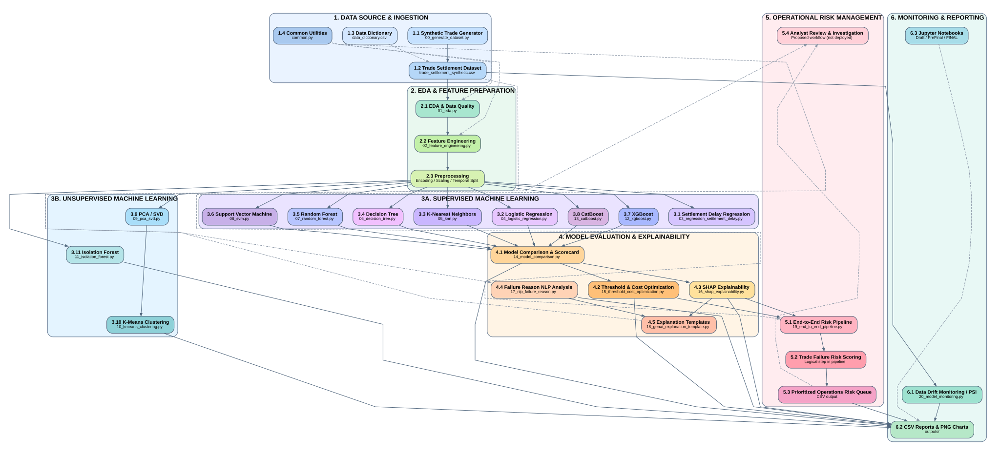

# AI-Powered Intelligent Trade Settlement Failure Prediction and Explainable Risk Management System

**UC Berkeley Professional Certificate in Machine Learning & Artificial Intelligence — Capstone Project**

**Author:** Rama Nuti  
**GitHub:** [ramakrishna580](https://github.com/ramakrishna580/)

## Executive summary

This capstone investigates whether pre-settlement trade and operational signals can identify securities transactions at elevated risk of settlement failure, enabling operations teams to prioritize preventive action. It combines supervised failure classification, settlement-delay regression, exploratory and statistical analysis, unsupervised segmentation, anomaly detection, explainability, and an operations-oriented risk queue. The analysis uses **synthetic trade settlement data**, so results are educational demonstrations rather than validated production performance.

## System Architecture

The numbered, color-coded architecture below illustrates the project's data ingestion, EDA and feature preparation, supervised and unsupervised machine learning, evaluation and explainability, operations risk prioritization, and monitoring/reporting. Each box has a distinct background color and a bold title. Solid arrows show principal dependencies; dashed arrows show supporting or proposed connections.



[View full-size PNG](docs/Trade_Failure_System_Architecture.png) · [View editable Graphviz source](docs/Trade_Failure_System_Architecture.dot)

**Scope:** This is a research architecture using synthetic data, not a deployed trading system. Analyst review is a proposed workflow; narrative explanations are template-based rather than an external LLM service. The numbers identify components and branches, not a strict execution sequence.

## Business rationale and research questions

Trade settlement failures can generate operational workload, liquidity and funding pressure, client disruption, and potential penalties. Rather than relying exclusively on post-event exception handling, this project asks:

1. Can information available before settlement predict `settlement_failed`?
2. Which trade, counterparty, standing settlement instruction (SSI), timing, and operational features are associated with higher risk?
3. How do baseline and advanced models compare under a low failure rate?
4. Can models estimate `settlement_delay_hours` as a separate regression problem?
5. Can predictions be converted into explainable, actionable, prioritized trade-review queues?

## Data sources and scope

The notebooks use a **synthetic** trade-settlement CSV named `trade_settlement_synthetic.csv`, with features related to trade characteristics, counterparties, SSI, confirmation/allocation/affirmation delays, operational touches, and settlement outcomes. The recorded final notebook output reports **25,000 rows and 37 columns**, trade dates **2023-01-02 through 2025-11-28**, **zero duplicate trade IDs**, and a **1.96% settlement failure rate**. These are notebook-recorded results, not a fresh independent rerun.

The main classification target is `settlement_failed`. `settlement_delay_hours` is analyzed as a **separate regression target**. Outcome-derived information, including final failure reasons and realized settlement delay, must not leak into the pre-settlement classifier. Post-event failure-description classification is intentionally a separate NLP use case.

**Data availability:** Your repository listing includes `data/trade_settlement_synthetic.csv` and `data/data_dictionary.csv`. These data files were listed but not attached individually for inspection. If missing in a fresh checkout, use `src/00_generate_dataset.py` or the data-generation workflow, then confirm the CSV path resolves.

## Methodology

- **Data validation and EDA:** schema, duplicates, missing values, base rates, and outcome relationships across SSI status, asset class, inventory indicators, trade size, and operational delays.
- **Statistical tests:** chi-square association test for SSI status versus settlement outcome; Mann–Whitney U test for confirmation-delay distributions.
- **Feature engineering:** log trade amount, transformed delays, aggregate processing delays, operational touch counts, and counterparty risk indicators.
- **Temporal evaluation and leakage prevention:** chronological data partitioning; preprocessing fit on training data; pre-outcome predictors only.
- **Classification:** Logistic Regression, K-Nearest Neighbors, Decision Tree, Random Forest, Support Vector Machine, XGBoost, and CatBoost.
- **Regression:** Linear Regression, Ridge, and Random Forest regression for settlement delay, assessed with regression error metrics.
- **Unsupervised analysis:** PCA/SVD, K-Means operational-risk segments, and Isolation Forest anomaly detection.
- **Rare-event evaluation:** precision, recall, F1, ROC-AUC, PR-AUC, threshold sensitivity, and confusion matrices; overall accuracy alone is insufficient.
- **Operationalization:** illustrative false-negative versus investigation-cost tradeoffs, risk thresholds, explainability via SHAP, and ranked operations queues.
- **NLP and GenAI:** TF-IDF-based classification of *post-event* failure descriptions; a grounded, rule/template-based risk narrative. The narrative demonstration does **not** train or call an external large language model.
- **Monitoring and governance:** population stability index (PSI), drift monitoring, human oversight, lineage, auditability, and model validation.

## Results and interpretation

The synthetic data is **highly imbalanced** (1.96% failures). The final notebook's saved outputs report the following **test-set metrics at the notebook's evaluation settings**:

| Classifier | Precision | Recall | F1 | ROC-AUC | PR-AUC |
|---|---:|---:|---:|---:|---:|
| Logistic Regression | 0.0494 | 0.6301 | 0.0916 | 0.7781 | 0.1308 |
| K-Nearest Neighbors | 0.0000 | 0.0000 | 0.0000 | 0.5449 | 0.0311 |
| Decision Tree | 0.0333 | 0.6027 | 0.0631 | 0.6389 | 0.0648 |
| Random Forest | 0.0000 | 0.0000 | 0.0000 | 0.7166 | 0.0802 |
| Support Vector Machine | 0.0000 | 0.0000 | 0.0000 | 0.5265 | 0.0256 |
| XGBoost | 0.1192 | 0.2466 | 0.1607 | 0.6950 | 0.0918 |
| CatBoost | 0.1298 | 0.2329 | 0.1667 | 0.7065 | 0.1169 |

**Interpretation:** Logistic Regression has the highest recorded PR-AUC and recall among these saved final-notebook outputs, but low precision means substantial review workload. CatBoost has the highest recorded F1 and precision at the reported operating point. The appropriate model and alert threshold depend on the organization's tolerance for missed failures versus false alarms. Models with high accuracy but zero failure recall are not useful for detecting rare failures at that threshold. Results may differ across notebook versions or reruns.

The notebooks also demonstrate cost-sensitive threshold selection using **hypothetical** values of **$5,000 per missed failure** and **$50 per false-positive investigation**; these are **not** actual institutional costs. Do not interpret synthetic model results or illustrative cost assumptions as realized financial savings.

## Source code and project directory hierarchy

The following tree reflects the repository listing provided for `UCBerkeleyTradeFailureAIMLCapstoneFinal`. File names and capitalization are preserved exactly as listed. The hierarchy is documentation of the supplied repository inventory; the `src/`, `outputs/`, and dataset files were not individually uploaded for independent inspection.

```text
UCBerkeleyTradeFailureAIMLCapstoneFinal/
├── README.md
├── requirements.txt
├── data/
│   ├── data_dictionary.csv
│   └── trade_settlement_synthetic.csv
├── notebooks/
│   ├── UC_Berkeley_Capstone_AI_Trade_Failure_Draft.ipynb
│   ├── UC_Berkeley_Capstone_AI_Trade_Failure_PreFinal.ipynb
│   ├── UC_Berkeley_Capstone_AI_Trade_Failure_FINAL.ipynb
│   └── catboost_info/
│       └── learn/
│           └── events.out.tfevents
├── src/
│   ├── common.py
│   ├── 00_generate_dataset.py
│   ├── 01_eda.py
│   ├── 02_feature_engineering.py
│   ├── 03_regression_settlement_delay.py
│   ├── 04_logistic_regression.py
│   ├── 05_knn.py
│   ├── 06_decision_tree.py
│   ├── 07_random_forest.py
│   ├── 08_svm.py
│   ├── 09_pca_svd.py
│   ├── 10_kmeans_clustering.py
│   ├── 11_isolation_forest.py
│   ├── 12_xgboost.py
│   ├── 13_catboost.py
│   ├── 14_model_comparison.py
│   ├── 15_threshold_cost_optimization.py
│   ├── 16_shap_explainability.py
│   ├── 17_nlp_failure_reason.py
│   ├── 18_genai_explanation_template.py
│   ├── 19_end_to_end_pipeline.py
│   └── 20_model_monitoring.py
├── outputs/
│   ├── 01_target_distribution.png
│   ├── 01_top_counterparty_risk.csv
│   ├── 02_failure_by_asset_class.png
│   ├── 02_engineered_feature_sample.csv
│   ├── 03_failure_by_ssi.png
│   ├── 03_regression_results.csv
│   ├── 04_failure_by_market.png
│   ├── 04_logistic_metrics.csv
│   ├── 05_failure_by_confirmation_delay.png
│   ├── 05_knn_metrics.csv
│   ├── 06_decision_tree_metrics.csv
│   ├── 07_random_forest_metrics.csv
│   ├── 08_svm_metrics.csv
│   ├── 09_pca_variance.csv
│   ├── 09_pca_scree.png
│   ├── 10_kmeans_selection.csv
│   ├── 10_kmeans_elbow.png
│   ├── 10_cluster_profiles.csv
│   ├── 11_top_anomalies.csv
│   ├── 12_xgboost_metrics.csv
│   ├── 13_catboost_metrics.csv
│   ├── 14_model_scorecard.csv
│   ├── 15_threshold_cost_curve.csv
│   ├── 16_local_shap_examples.csv
│   ├── 16_global_shap_importance.csv
│   ├── 17_nlp_classification_report.csv
│   ├── 19_operations_risk_queue.csv
│   └── 20_data_drift_psi.csv
└── catboost_info/
    ├── learn/
    ├── tmp/
    ├── time_left.tsv
    ├── learn_error.tsv
    └── catboost_training.json
```

### Directory responsibilities

| Path | Description |
|---|---|
| [`README.md`](README.md) | Project overview, setup, evaluation, and repository guide |
| [`requirements.txt`](requirements.txt) | Python dependency manifest; install with `pip install -r requirements.txt` |
| [`data/`](data/) | Synthetic settlement dataset and accompanying data dictionary |
| [`notebooks/`](notebooks/) | Draft, pre-final, and final Jupyter notebooks documenting the capstone progression |
| [`src/`](src/) | Modular scripts for data generation, feature engineering, modeling, interpretation, and monitoring |
| [`outputs/`](outputs/) | Generated charts, CSV metrics, model comparisons, explanations, and operations-risk queue |
| `catboost_info/` | CatBoost training logs and diagnostic artifacts (generated during training) |
| `notebooks/catboost_info/` | Additional CatBoost event logs created from notebook execution |

### Source module map

| Stage | Source modules | Intended function (inferred from filenames) |
|---|---|---|
| Data preparation | `00_generate_dataset.py`, `01_eda.py`, `02_feature_engineering.py`, `common.py` | Generate data, inspect quality and distributions, engineer predictors, share utilities |
| Regression | `03_regression_settlement_delay.py` | Estimate settlement delay |
| Baseline classification | `04_logistic_regression.py` through `08_svm.py` | Compare logistic regression, KNN, tree, forest, and SVM classifiers |
| Unsupervised learning | `09_pca_svd.py`, `10_kmeans_clustering.py`, `11_isolation_forest.py` | Dimensionality reduction, segmentation, anomaly detection |
| Advanced classification | `12_xgboost.py`, `13_catboost.py` | Gradient-boosted classification experiments |
| Model selection | `14_model_comparison.py`, `15_threshold_cost_optimization.py` | Consolidate model metrics and explore operating thresholds and hypothetical costs |
| Explainability and text | `16_shap_explainability.py`, `17_nlp_failure_reason.py`, `18_genai_explanation_template.py` | Explain predictions, classify post-event failure text, and generate grounded explanations |
| Workflow and monitoring | `19_end_to_end_pipeline.py`, `20_model_monitoring.py` | Risk-queue workflow and drift monitoring |

### Notebooks

- **[Draft notebook](notebooks/UC_Berkeley_Capstone_AI_Trade_Failure_Draft.ipynb)** — initial experiments and development.
- **[Pre-final notebook](notebooks/UC_Berkeley_Capstone_AI_Trade_Failure_PreFinal.ipynb)** — integrated modeling and evaluation workflow.
- **[Final notebook](notebooks/UC_Berkeley_Capstone_AI_Trade_Failure_FINAL.ipynb)** — final capstone notebook with comprehensive scenario coverage.

**Naming note:** Your latest repository listing uses `UC_Berkeley_Capstone_AI_Trade_Failure_FINAL.ipynb` (uppercase `FINAL`). On case-sensitive systems, this is different from the previously requested `UC_Berkeley_Capstone_AI_Trade_Failure_Final.ipynb`. The links above match the latest listing.

### Generated output guide

- **EDA:** `01_target_distribution.png`, `02_failure_by_asset_class.png`, `03_failure_by_ssi.png`, `04_failure_by_market.png`, and `05_failure_by_confirmation_delay.png`.
- **Model results:** `03_regression_results.csv`, `04_logistic_metrics.csv` through `08_svm_metrics.csv`, `12_xgboost_metrics.csv`, `13_catboost_metrics.csv`, and `14_model_scorecard.csv`.
- **Feature/unsupervised artifacts:** `02_engineered_feature_sample.csv`, `09_pca_variance.csv`, `09_pca_scree.png`, `10_kmeans_selection.csv`, `10_kmeans_elbow.png`, `10_cluster_profiles.csv`, and `11_top_anomalies.csv`.
- **Decision support:** `15_threshold_cost_curve.csv`, `16_local_shap_examples.csv`, `16_global_shap_importance.csv`, `17_nlp_classification_report.csv`, `19_operations_risk_queue.csv`, and `20_data_drift_psi.csv`.

The `outputs/` files are generated artifacts rather than manually maintained source data. `catboost_info/` contains generated training diagnostics; consider excluding transient logs from version control if they are not needed for reproducibility.

## Setup and execution

1. Use Python 3 with JupyterLab or Jupyter Notebook.
2. From the repository root, install the declared dependencies: `pip install -r requirements.txt` (prefer a dedicated virtual environment).
3. If the environment reports missing advanced packages, verify `xgboost`, `catboost`, and `shap` are installed and compatible. The final notebook also includes environment/dependency checks.
4. Confirm `data/trade_settlement_synthetic.csv` exists; if not, use the synthetic-data generator and verify paths relative to the repository root.
5. Run the **pre-final** notebook in sequence from top to bottom, or run the **final** notebook's scenario sections as described within that notebook.
6. Inspect actual metrics, visualizations, and output tables after execution; do not assume saved outputs will exactly reproduce on another environment.

No Groq or OpenAI API key is required for these uploaded capstone notebooks' grounded narrative demonstration.

## Limitations and responsible use

The data is synthetic and may encode assumptions not representative of live securities settlement. The experiment does not establish performance on real trading infrastructure. The notebooks do not demonstrate production deployment, live market integration, or validated real-world cost reduction. Thresholds, monitoring parameters, and recommendations are illustrative. Any real deployment would require point-in-time data integrity, independent validation, privacy and security review, explainability, drift controls, audit trails, and human decision-making.

## Next steps

Validate on anonymized real trade data with permission; compare models on out-of-time cohorts; calibrate probabilities; tune alert volumes and thresholds against approved business costs; test generalization by asset class, market, and counterparty; strengthen local explanations; and explore controlled intraday rescoring, event-stream ingestion, and operational monitoring.

## Contact and further information

**Author:** Rama Nuti  
**GitHub profile:** https://github.com/ramakrishna580/  
**Contact:** Please reach out through the GitHub profile. No public email address was provided.

## Notebook progression and deliverables

The **draft** provides a reproducible starting point and synthetic data generator. The **pre-final** organizes the business question, exploration, experiments, model comparison, interpretability, and recommendations into a continuous report. The **final** reformats the work into independent scenarios for data validation, leakage control, EDA, regression, classification, clustering, anomaly detection, NLP, grounded risk narratives, a high-risk trade queue, and PSI monitoring.

### Submission verification checklist

- [ ] Input CSV is available and the data path resolves.
- [ ] Notebook kernel is restarted and all intended sections run successfully.
- [ ] Data leakage exclusions are confirmed.
- [ ] Model comparison metrics reflect the latest run.
- [ ] Results and charts are retained and interpreted accurately.
- [ ] Synthetic-data and hypothetical-cost limitations are explicit.
- [x] Author name and GitHub profile are included; add a public email address only if desired.
